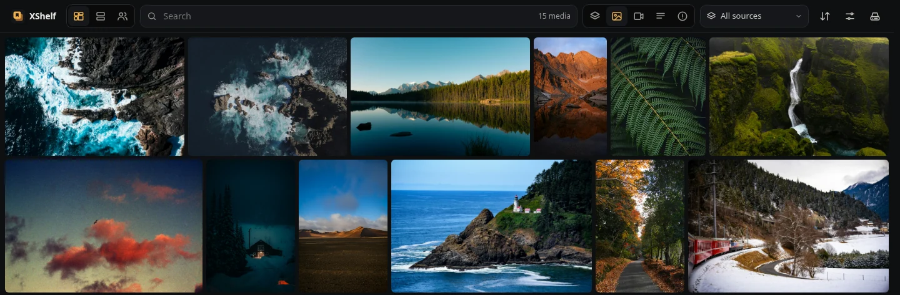
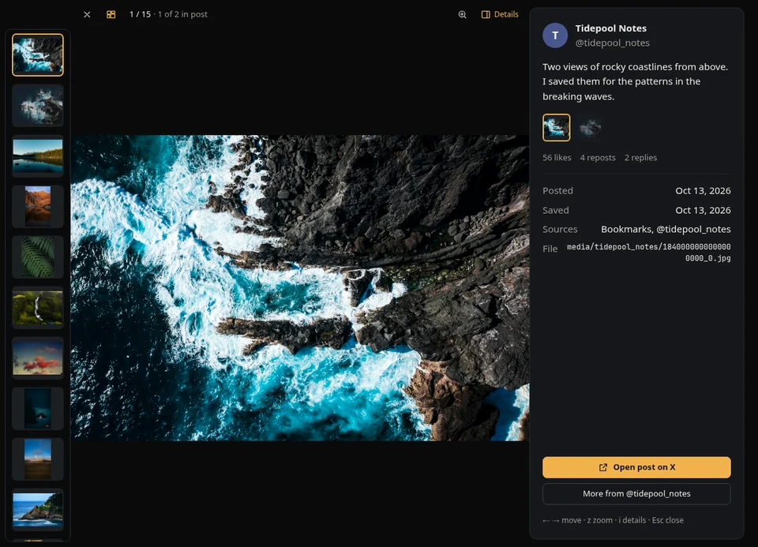
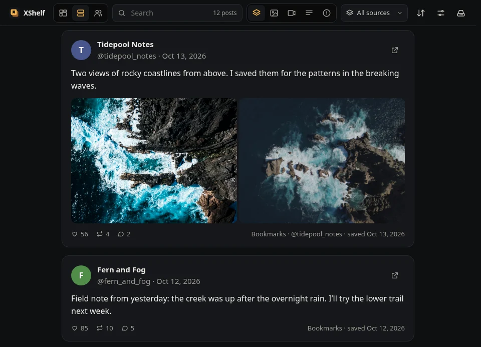

<p align="center">
  
</p>

<h1 align="center">XShelf</h1>

<p align="center">
  An offline archive for your X (Twitter) bookmarks and profile posts.<br>
  Bookmark on your phone. Back up on your computer later.
</p>



- **Back up bookmarks and profiles.** Save post text, original links, author and engagement details, and available images and videos.
- **Browse offline.** Open the Explorer from your Downloads folder. Use **Wall** for media, **Feed** for full posts, or **People** to browse by author.
- **Find and view media.** Search and filter across sources, then open photos and videos in a lightbox with zoom and a scrollable thumbnail rail.
- **Check the archive.** Scan for missing files and export a list the extension can use to queue downloads.

<table>
  <tr>
    <td width="50%" valign="top"></td>
    <td width="50%" valign="top"></td>
  </tr>
  <tr>
    <td align="center"><sub>Lightbox</sub></td>
    <td align="center"><sub>Feed</sub></td>
  </tr>
</table>

## Getting started

> [!WARNING]
> **Use XShelf at your own risk.** Changes to X can interrupt a backup or leave gaps in your archive. Check that the posts and media you want are saved before using **Cleanup**, which removes bookmarks from your X account.

Build with Node.js and pnpm. XShelf is designed for desktop Chrome, Brave, and Edge on Windows, macOS, and Linux. The builds and mock browser checks have been run on Linux.

```sh
git clone https://github.com/Nynxz/xshelf.git
cd xshelf
pnpm install --frozen-lockfile
pnpm build
```

1. Open `chrome://extensions`, enable **Developer mode**, and load `.output/chrome-mv3` as an unpacked extension. It appears as **X Bookmark Downloader**.
2. On your computer, sign in to the same X account you bookmark from. Open **Bookmarks** and scroll to load another page, then open the extension and click **Sync your bookmarks**.
3. Review the pending media, click **Download all**, then click **Open Explorer**.

For Firefox, see the [temporary add-on instructions](docs/usage.md#firefox).

## Documentation

| Guide | Covers |
| --- | --- |
| [Usage](docs/usage.md) | Profile backups, full scans, archive files, missing media, and permissions |
| [Development](docs/development.md) | Building and packaging the extension, and project layout |
| [Photo credits](docs/screenshots/CREDITS.md) | Unsplash photos used in the screenshots |

## Privacy

Backups use your existing X session. The extension saves archive files locally, and the Explorer loads them from disk.
